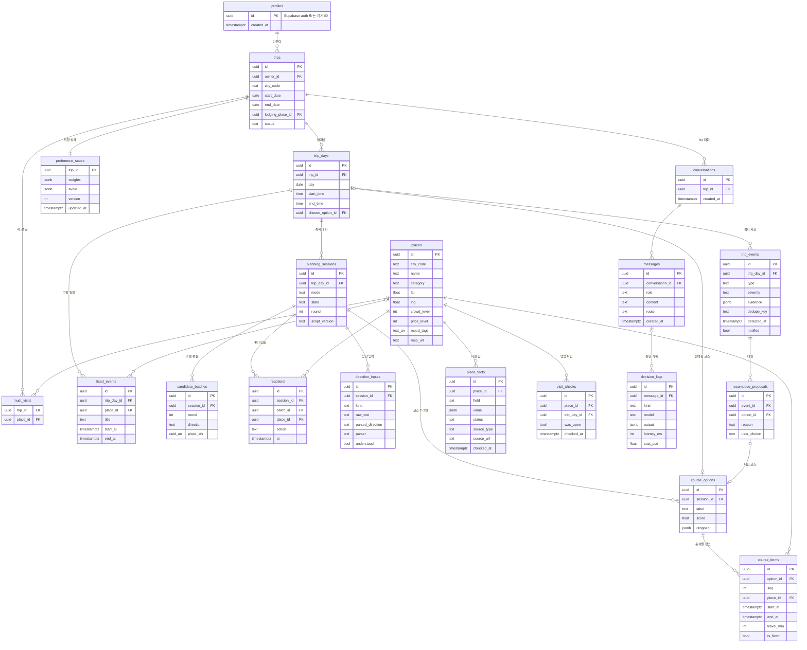

# DATA-001 · 데이터 모델과 ERD (v4, R1~R2)

| 항목 | 내용 |
|---|---|
| 상태 | **초안** — PM 작성 2026-11-02, 결정권자 검토 대기 |
| 입력 | SRS-001 · SCN-001 · ADR-012(장소 출처 정책) · ADR-013(구조) |
| 저장소 | Supabase(Postgres). 진실의 원천은 여기 하나. LangGraph 상태는 대화 맥락만 담는다 |
| 원칙 | 사실 값은 **출처·확인 날짜·상태와 함께** 저장 · 위치 이동 경로는 저장하지 않음 · 대화 원문은 보관 기간을 둠 |

## 1. 영역
| 영역 | 테이블 | 쓰는 기능 |
|---|---|---|
| A. 사용자·여행 | profiles, trips, trip_days, fixed_events, must_visits | FR-01, FR-32·33 |
| B. 장소 | places, place_facts | FR-02, FR-14·15, ADR-012 |
| C. 계획 대화 | planning_sessions, candidate_batches, reactions, direction_inputs, preference_states | FR-02~02c |
| D. 코스 | course_options, course_items | FR-03~07 |
| E. 여행 중 | trip_events, recompose_proposals, visit_checks | FR-11~19 |
| F. 대화·기록 (R2) | conversations, messages, decision_logs | FR-20~27, 측정 M-21~27 |

## 2. ERD

그림 파일: 저장소 `docs/ERD-v4.png` (위 정의에서 생성)

## 3. 테이블 상세 (핵심만)
### A. 사용자·여행
| 테이블 | 핵심 열 | 규칙 |
|---|---|---|
| profiles | id | R1은 기기 ID로 시작, 로그인하면 계정으로 옮김 (FR-32). 전화번호·실명 없음 |
| trips | city_code, start_date, end_date, lodging_place_id, status(`planning`/`active`/`done`) | city_code는 지역 팩 키 (NFR-15) |
| trip_days | day, start_time, end_time, chosen_option_id | 하루 1행. 선택한 코스를 가리킴 |
| fixed_events | start_at, end_at, place_id(없어도 됨) | **재조합 때 절대 지킴** (AC-05) |
| must_visits | trip_id, place_id | 꼭 갈 곳 → 코스 계산의 고정 장소 |

### B. 장소 (ADR-012 출처 정책)
| 테이블 | 핵심 열 | 규칙 |
|---|---|---|
| places | name, category, lat/lng, crowd_level(1~5), price_level(1~4), mood_tags | 후보 추천·취향 추정에 쓰는 속성. 원문 리뷰·사진 복제 금지, 사진은 라이선스 확인된 것만 |
| place_facts | field(`opening_hours`, `closed_days`, `stay_min`(머무는 시간 범위 `{min, typical, max}`, FR-07a), …), value, **status**(`confirmed`/`unverified`/`unknown`), **source_type**(`official`/`api`/`collected`/`user`/`estimate`), source_url, checked_at | 장소의 사실 값은 항상 여기서. 화면 신뢰 순서: official·user > collected > estimate > unknown (NFR-07) |

### C. 계획 대화 (FR-02~02c)
| 테이블 | 핵심 열 | 규칙 |
|---|---|---|
| planning_sessions | mode(`conversation`/`auto`), state(`asking`/`browsing`/`composing`/`done`), round, script_version | R1 대본 버전을 기록해 R2 LLM과 비교 (M-27) |
| candidate_batches | round, direction, place_ids(5~6개) | 어떤 후보를 어떤 방향으로 보여 줬는지 |
| reactions | action(`like`/`skip`/`unlike`) | **넘김도 기록** → 암묵적 취향 추정 (FR-02b, AC-17). "담은 곳" = like 중 unlike 안 된 것 |
| direction_inputs | kind(`chip`/`text`), raw_text, parsed_direction, parser(`rule`/`llm`), understood | 직접 입력 해석 성공률을 규칙 vs LLM으로 비교 (AC-17a) |
| preference_states | weights(속성별 가중치), avoid(피할 조건), version | 여행 단위 취향 상태. 다른 날 계획에 이어서 씀 |

### D. 코스
| 테이블 | 핵심 열 | 규칙 |
|---|---|---|
| course_options | label(`relaxed`/`packed`), score, dropped(넣지 못한 장소와 이유) | 2~3안. 불가능하면 dropped에 이유 (FR-07) |
| course_items | seq, start_at, end_at, travel_min, is_fixed, **stay_source**(`auto`/`user`) | 영업시간·고정 일정·이동 시간 위반 0건 (NFR-04, 속성 기반 테스트). 사용자가 바꾼 시간(`user`)은 다시 계산할 때 지킨다 |

### E. 여행 중
| 테이블 | 핵심 열 | 규칙 |
|---|---|---|
| trip_events | type(`delay`/`closed`/`last_train`/`weather`), severity, evidence, **dedupe_key** | 같은 사건 한 번만 알림 (FR-19, AC-10) |
| recompose_proposals | option_id, reason, user_choice(`accepted`/`dismissed`/null) | **사용자가 고르기 전에는 일정 안 바꿈** (FR-13, AC-06) |
| visit_checks | was_open, checked_at | 방문 전 영업 확인 답. place_facts에 `user` 출처로 반영 (FR-15) |

### F. 대화·기록 (R2)
| 테이블 | 핵심 열 | 규칙 |
|---|---|---|
| conversations, messages | role, content, route(`chat`/`request`/`clarify`/`safety`) | 원문은 30일 보관 후 삭제 (가설, 개인정보 처리방침에 명시) |
| decision_logs | kind(`router`/`composer`/`parser`), model(`rule`/`jev`/`llm`), output(선택·확률), latency_ms, cost_usd | 측정 M-21~24·27의 원자료. 개인 식별 정보 없이 저장 |

## 4. 저장하지 않는 것
- 이동 경로, 백그라운드 위치 기록 (목적지 근처 판정 결과만 trip_events에)
- 전화번호, 실명, 결제 정보
- 외부 리뷰·블로그 원문, 라이선스 없는 사진
- API 키 등 비밀값 (서버 환경 변수에만)

## 5. 열린 질문
| ID | 질문 |
|---|---|
| OQ-D1 | 취향 상태를 여행 단위로 둘지, 사용자 단위로 누적할지 (지금은 여행 단위) |
| OQ-D2 | crowd_level의 출처 (시간대별 혼잡 데이터 확보 가능성, 도시 조사 후) |
| OQ-D3 | 오프라인용 기기 저장 범위 (오늘 일정 + SOS, NFR-16) |

## 포트폴리오 포인트
- **보여주는 것**: 사실 값마다 출처·상태를 붙인 데이터 구조, 넘김까지 기록해 암묵적 취향을 추정하는 설계, 측정(규칙 vs LLM)을 위한 판단 기록 테이블
- **예상 면접 질문**: "AI가 틀린 정보를 주지 않게 데이터는 어떻게 설계했나요?" → "사실 값을 place_facts로 분리하고 출처 종류·확인 날짜·상태를 같이 저장했다. 화면과 LLM은 이 테이블 값만 쓰고, 상태가 unknown이면 '모름'으로 보여 준다"
