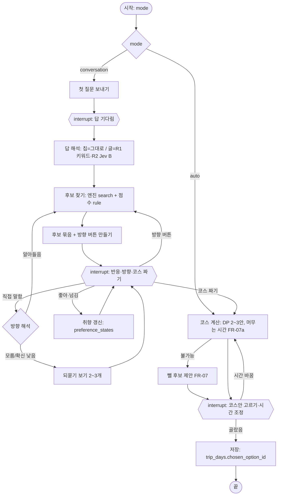
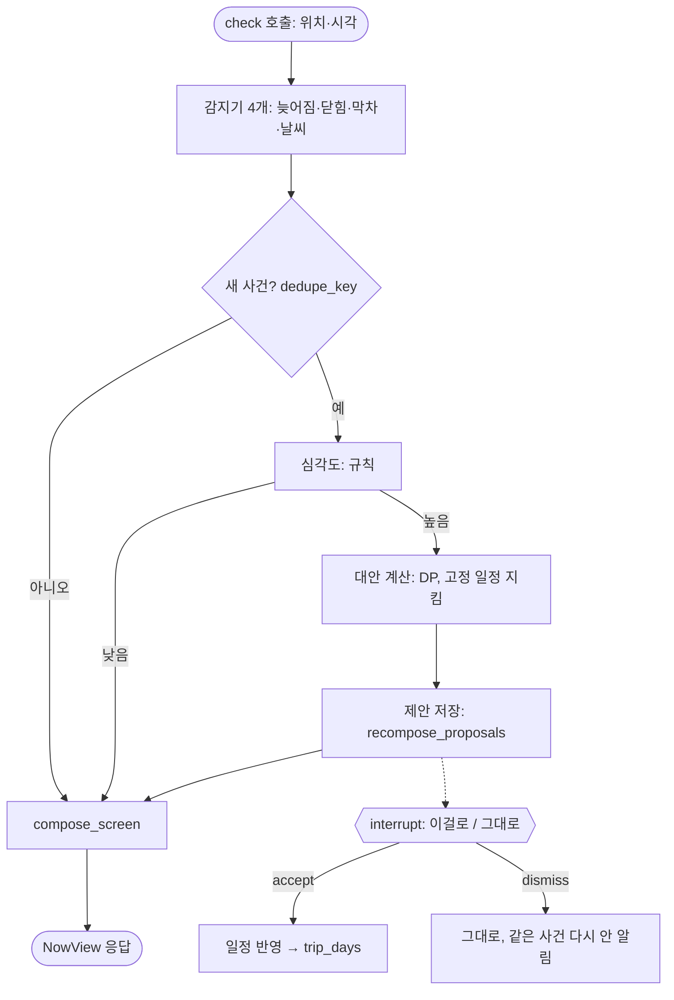
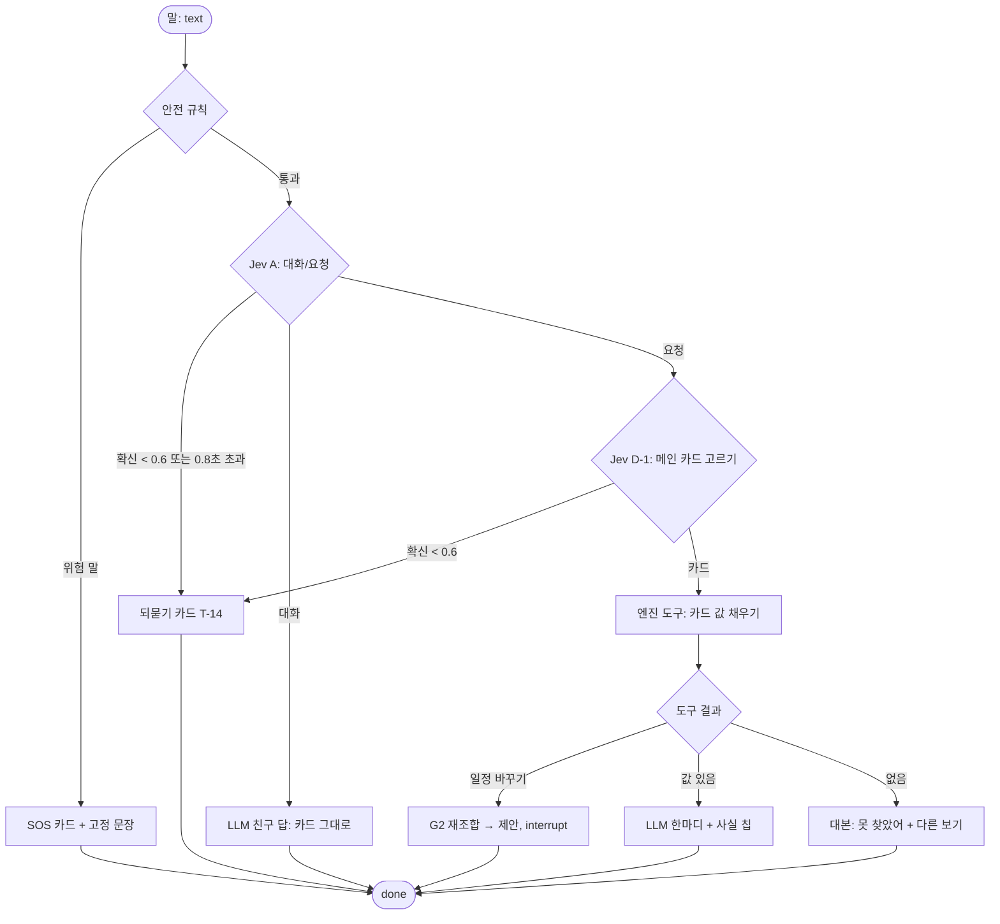

# GRAPH-001 · LangGraph 그래프 설계 (v4, R1~R2)

| 항목 | 내용 |
|---|---|
| 상태 | **승인** — PM 작성, 결정권자 승인 2026-11-03 (OQ-G1·G2 제안대로) |
| 입력 | ADR-011(Jev 사용처, 측정 결과) · ADR-012(에이전트 원칙) · ADR-013(구조) · SRS-001 · SCREEN-001 · API-001 · DATA-001 |
| 원칙 | ① 그래프는 **정해진 흐름**이고 AI는 필요한 노드에만 ② 사실과 일정 변경은 **엔진 함수**만 ③ 모든 AI 노드에 **시간 제한 + 규칙 대체** ④ 사용자가 고르기 전에는 일정을 바꾸지 않음(interrupt) ⑤ 모든 판단은 `decision_logs`에 |

## 0. 그래프 4개와 화면 조합 함수
| 그래프 | 언제 | 출시 | API |
|---|---|---|---|
| G1 계획 대화 | 날짜별 "같이 고르기" | **R1** (규칙 노드) → R2 (LLM·Jev 노드로 교체) | `/planning/*` |
| G2 여행 중 감지·재조합 | 앱이 `check`를 부를 때 | **R1** | `/days/{id}/check`, `/proposals/*` |
| G3 대화 친구 | 입력창에 말할 때 | R2 | `/chat` (SSE) |
| G4 장소정보 수집 | 예약 실행 | R1 (ADR-012) | 내부 |
| `compose_screen()` | G2·G3 결과 뒤, `now` 호출 | R1 | `/days/{id}/now` |

> **R1부터 LangGraph로 만든다 (11-03 결정).** R1 계획 대화는 LLM 없이 규칙 노드만 있는 그래프이고, R2에서 같은 그래프의 노드만 LLM·Jev로 바꾼다. 그래서 "대본 vs LLM"(M-27)을 **같은 그래프, 다른 노드**로 비교할 수 있다

## 1. 공통
### 1-1. 상태와 저장
| 항목 | 내용 |
|---|---|
| 그래프 상태 | pydantic 모델. **대화 맥락만** (현재 단계, 직전 후보 묶음 ID, 되묻기 횟수 등). 일정·장소·반응은 Supabase가 원본 (ADR-013) |
| 체크포인터 | `langgraph-checkpoint-postgres` (Supabase Postgres). interrupt 후 재개, 앱을 껐다 켜도 이어짐. 스레드 ID = `planning_session_id` / `trip_day_id` / `conversation_id` |
| 재개 | 사용자 선택은 `Command(resume=...)`로 같은 스레드에 넣는다 |

### 1-2. AI 노드 공통 규칙
| 규칙 | 값 |
|---|---|
| Jev 호출 | `JevDecider` 하나로 (ADR-013 `deciders`). 시간 제한 **0.8초**, 확신 **0.6** 미만이면 되묻기 (ADR-011) |
| LLM 호출 | 말투·설명만. 사실 값은 상태에 넣어 준 엔진 결과만 인용. 시간 제한 8초(가설), 실패하면 대본 문장 |
| 실패 | 시간 초과·오류 → **규칙 경로**로. 그래프는 멈추지 않는다 |
| 기록 | 모든 판단 노드가 `decision_logs`(kind, model, output, latency_ms, cost_usd)에 한 줄 |
| 상한 | 한 번 실행에 LLM 2회, Jev 3회, 도구 5회 (가설). 넘으면 규칙 경로 |

### 1-3. 스트리밍 (G3)
`stream_mode=["updates","custom"]` → SSE 이벤트: `route` → `token`… → `cards` → `done` (API-001 §2-4)

## 2. G1 계획 대화

| 노드 | R1 | R2 | 비고 |
|---|---|---|---|
| 첫 질문 | 대본 문장 | LLM 말투 (질문 내용은 대본 고정) | FR-02 |
| 답·방향 해석 | 키워드 규칙 | **Jev B** + unknown이면 규칙 | ADR-011 B. 되묻기 최대 1번, 그다음은 추정만으로 |
| 후보 찾기·점수 | 엔진 + 규칙 가중치 | 같음 | ADR-011 C: Jev 기각 |
| 방향 버튼 고르기 | 규칙 (지금 묶음에서 가장 차이 나는 속성 2~3개) | 같음 (측정 전) | FR-02c·10c |
| 후보 한마디 ("왜") | 대본 틀 ("○○ 취향과 비슷해요") | LLM | 사실 값 금지 |
| 코스 계산 | DP | 같음 | NFR-04, 속성 기반 테스트 |

## 3. G2 여행 중 감지·재조합

- **심각도는 규칙** (ADR-013 표의 "심각도(Jev)"를 정정. ADR-011에서 측정 안 된 자리는 규칙). 예: 다음 일정 시작까지 남은 여유 < 지연 → 높음
- interrupt는 제안마다 하나. 앱은 `/proposals/{id}/accept|dismiss`로 재개 (AC-06: 고르기 전엔 일정 그대로)
- 위치는 상태·DB에 저장하지 않는다. 감지 결과(사건)만 저장 (NFR-10)

## 4. G3 대화 친구 (R2)

| 노드 | 담당 | 근거 |
|---|---|---|
| 안전 | 규칙 (키워드 목록) | 모델 거치지 않음 (ADR-013) |
| 대화/요청 | Jev A | 명확 92.3% (ADR-011) |
| 메인 카드 | Jev D-1 | 요청 문장 100% vs 규칙 42.9% (POC-001 §8) |
| 보조 카드 | 규칙 짝 표 | SCREEN-001 §5 |
| 카드 값 | 엔진 도구 (`search_nearby`, `get_route`, `get_schedule`, `recompose`) | 사실은 DB·엔진만 |
| 말투 | LLM | 사실 값은 칩으로 따로 (FR-23) |

## 5. G4 장소정보 수집 (ADR-012 요약)
`검색 → 읽기 → 추출(LLM) → 인용 대조 → 저장`. 도구 5회·시간 상한, 확인 못 한 값은 `unknown`, 출처·날짜 필수, 원문·사진 복제 금지. 상세는 ADR-012

## 6. `compose_screen()` (그래프가 아닌 함수)
1. 안전·오프라인 → 고정
2. 고정 일정 임박 (§4-1 순위 2) → T-07
3. **G3가 고른 메인 카드** (사용자의 말이 나머지보다 우선, 11-03 정리)
4. SCREEN-001 §4-1 나머지 순위 (늦어짐, 닫힘, 이동, 영업 확인, 일정 끝)
5. §4-2a 강한 신호 4개 → 메인 변경 / 약한 신호 → 제안 칩
6. 짝 표로 보조 카드, 변경 규칙(30초·3분)으로 깜빡임 막기, 바뀐 이유 문장

순수 함수로 두고 **TDD 대상** (입력: 상황 스냅샷 → 출력: 카드 ID 목록 + 이유)

## 7. 테스트와 측정
| 대상 | 방법 |
|---|---|
| 엔진·`compose_screen`·안전 규칙 | pytest TDD, 속성 기반 테스트 (TEAM-001 §4-1) |
| 그래프 경로 | 가짜 `JevDecider`·LLM으로 경로 테스트: 확신 낮음 → 되묻기, 시간 초과 → 규칙, interrupt 후 재개 |
| AI 노드 | 평가 세트 (POC-001 gold A·B·D) 회귀 측정, M-21·27 |
| 관측 | `decision_logs` → R2 웹 대시보드 (노드 경로, 지연, 비용) |

## 8. 열린 질문
| ID | 질문 | 제안 |
|---|---|---|
| OQ-G1 | R1 계획 대화를 LangGraph로 할지, 단순 상태 기계 코드로 할지 | **결정: LangGraph** (11-03) |
| OQ-G2 | `/planning`을 R2에서 `/chat`으로 합칠지 (OQ-A3) | **결정: 합치지 않음** (11-03). 계획은 버튼 중심, 대화는 자유 입력 |
| OQ-G3 | 상한 값 (LLM 2·Jev 3·도구 5, LLM 8초) | 가설, R2 측정 후 조정 |
| OQ-G4 | 체크포인트 보관 기간 | 여행 종료 + 30일 (대화 원문 보관과 같게, 가설) |

## 포트폴리오 포인트
- **보여주는 것**: 그래프마다 "어느 노드가 규칙·Jev·LLM·엔진인지"가 측정 근거와 함께 표로 있음. 실패 경로(시간 초과·확신 낮음)가 그림에 다 있음. interrupt로 "사용자가 고르기 전엔 안 바꾼다"를 구조로 보장
- **에이전트 관점**: 자율 에이전트가 아니라 **통제된 그래프**. 같은 그래프에서 노드만 바꿔 규칙 vs LLM을 비교
- **예상 면접 질문**
  - "LangGraph를 왜 썼나요? 그냥 함수 호출로 되지 않나요?" → "interrupt와 체크포인트로 사용자 확인을 기다렸다 재개하는 흐름, 노드 단위 교체·측정이 필요했다. 단순한 조합 로직(`compose_screen`)은 그래프로 만들지 않고 함수로 뒀다"
  - "모델이 늦거나 틀리면?" → "모든 AI 노드에 0.8초 제한과 확신 기준이 있고, 넘으면 규칙 경로나 되묻기로 간다. 그림의 모든 분기가 테스트 케이스다"
  - "사실 오류는 어떻게 막나요?" → "LLM 노드에는 엔진 결과만 상태로 넣고, 사실 값은 칩으로 따로 그린다. M-23으로 오류 수를 잰다"
